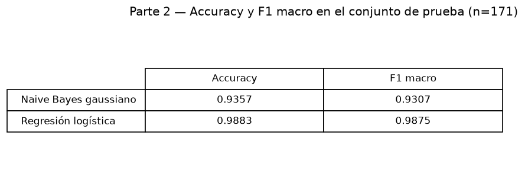
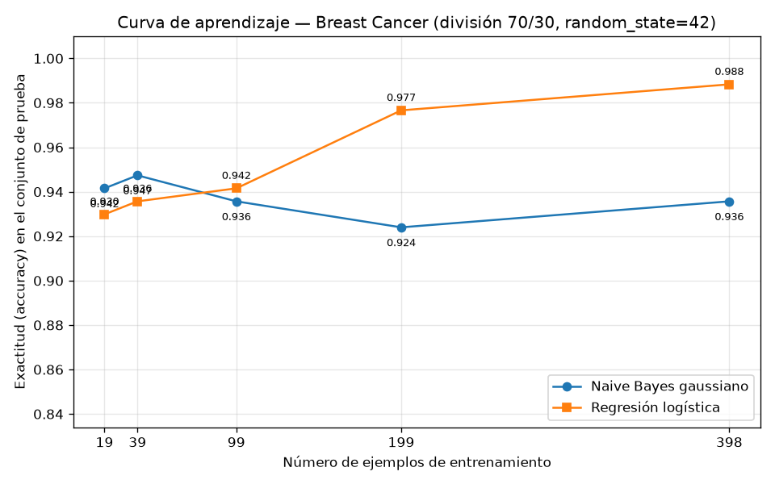

## Introducción

Ng y Jordan (2002) predijeron teóricamente que un clasificador generativo alcanza su error asintótico con menos ejemplos de entrenamiento que un clasificador discriminativo, aunque dicho error asintótico sea peor. Esta tarea comprueba esa predicción sobre datos reales usando el conjunto Breast Cancer Wisconsin (Diagnostic): se enfrentan un Naive Bayes gaussiano (generativo) y una regresión logística (discriminativa) en una curva de aprendizaje sobre una única división entrenamiento/prueba, y se analiza si aparece el cruce previsto entre las dos curvas de exactitud.

## Metodología

Se cargó el conjunto Breast Cancer Wisconsin (Diagnostic) con `sklearn.datasets.load_breast_cancer`, que contiene 569 ejemplos con 30 atributos, de los cuales 212 son de la clase malignant (proporción 0.3726) y 357 de la clase benign (proporción 0.6274). Los datos se dividieron en 70 % entrenamiento y 30 % prueba con estratificación por clase y `random_state=42`, obteniendo 398 ejemplos de entrenamiento (148 malignant, 250 benign) y 171 de prueba (64 malignant, 107 benign). Esta división es la única usada en toda la tarea: el conjunto de prueba nunca se empleó para ajustar nada.

Se entrenaron dos modelos: un Naive Bayes gaussiano y una regresión logística. Para la regresión logística los atributos se estandarizaron con un `StandardScaler` ajustado únicamente con el entrenamiento (la media máxima absoluta de los atributos escalados en entrenamiento fue 5.2168e-15, mientras que en prueba fue 0.2060, lo que confirma que el escalador no vio la prueba). Se midieron exactitud y F1 macro sobre el conjunto de prueba.

Para la curva de aprendizaje, ambos modelos se reentrenaron con submuestras estratificadas del entrenamiento correspondientes a las fracciones 0.05, 0.1, 0.25, 0.5 y 1.0 (con `random_state=42`), es decir, 19, 39, 99, 199 y 398 ejemplos, y se evaluaron siempre sobre el mismo conjunto de prueba de 171 ejemplos. En cada punto el escalador se reajustó solo con la submuestra correspondiente. La exactitud se graficó contra el número de ejemplos de entrenamiento, con una curva por modelo, y la figura se guardó como PNG.

## Resultados

La tabla siguiente resume el desempeño de ambos modelos sobre el conjunto de prueba con el entrenamiento completo (398 ejemplos):

| Modelo | Accuracy | F1 macro |
|---|---|---|
| Naive Bayes gaussiano | 0.9357 | 0.9307 |
| Regresión logística | 0.9883 | 0.9875 |

La curva de aprendizaje (exactitud contra número de ejemplos de entrenamiento) muestra la evolución de ambos modelos:

Los valores medidos de exactitud en cada tamaño de entrenamiento son:

| n entrenamiento | Naive Bayes gaussiano | Regresión logística |
|---|---|---|
| 19 | 0.9415 | 0.9298 |
| 39 | 0.9474 | 0.9357 |
| 99 | 0.9357 | 0.9415 |
| 199 | 0.9240 | 0.9766 |
| 398 | 0.9357 | 0.9883 |

Con muy pocos datos, el Naive Bayes gaussiano supera a la regresión logística: con 19 ejemplos obtiene 0.9415 frente a 0.9298, y con 39 ejemplos 0.9474 frente a 0.9357. El cruce ocurre entre 39 y 99 ejemplos: con 99 ejemplos la regresión logística ya lo supera (0.9415 frente a 0.9357). A partir de ahí la regresión logística mejora de forma sostenida hasta 0.9766 con 199 ejemplos y 0.9883 con 398, mientras que el Naive Bayes se estanca e incluso baja a 0.9240 con 199 ejemplos, terminando en 0.9357 con el entrenamiento completo.

## Discusión

Los resultados reproducen el patrón que predicen Ng y Jordan. En los regímenes de pocos datos (19 y 39 ejemplos) el modelo generativo gana: alcanza 0.9474 de exactitud con solo 39 ejemplos, prácticamente su nivel asintótico, pues con el entrenamiento completo obtiene 0.9357, un valor incluso inferior. Es decir, el Naive Bayes converge muy rápido a su error asintótico, que además es mayor: 0.9357 frente a 0.9883 de la regresión logística con 398 ejemplos. El cruce de las curvas entre 39 y 99 ejemplos es exactamente el fenómeno anunciado: cada modelo conviene en un régimen distinto —el generativo por debajo de unas decenas de ejemplos, el discriminativo a partir de unas decenas en adelante—.

La explicación vía sesgo y varianza es consistente con las cifras. El Naive Bayes gaussiano impone un sesgo fuerte: asume que los 30 atributos son condicionalmente independientes dada la clase, algo falso en este conjunto (los atributos de radio, perímetro y área, por ejemplo, están fuertemente relacionados). Ese sesgo alto le da baja varianza: con 19 ejemplos ya estima sus pocos parámetros (medias y varianzas por atributo y clase) de forma estable y alcanza 0.9415, y su curva se mueve en una banda estrecha (0.9240–0.9474) sin tendencia clara de mejora, señal de que ha saturado su capacidad. Más datos no corrigen el sesgo de la hipótesis de independencia, por eso su error asintótico es peor. La regresión logística, en cambio, tiene menor sesgo: no impone estructura sobre la distribución conjunta de los atributos y solo ajusta la frontera de decisión, pero sus parámetros se estiman con mayor varianza cuando hay pocos datos; por eso con 19 ejemplos rinde menos (0.9298). A medida que aumenta n, la varianza de su estimación disminuye y su menor sesgo le permite superar al generativo y seguir mejorando hasta 0.9883, sin señales de estancamiento entre 199 y 398 ejemplos (0.9766 a 0.9883).

En resumen, se observa el cruce predicho: el generativo domina en el régimen de pocos datos por su baja varianza pese a su sesgo alto, y el discriminativo domina con suficientes datos porque su menor sesgo compensa con creces su varianza inicial.

## Conclusiones

Sobre Breast Cancer Wisconsin (Diagnostic) con una división 70/30 estratificada (398 entrenamiento, 171 prueba), el experimento confirma cualitativamente a Ng y Jordan: el Naive Bayes gaussiano alcanza su desempeño casi asintótico con muy pocos ejemplos (0.9474 con 39) y gana a la regresión logística en los puntos de 19 y 39 ejemplos, pero su error asintótico es mayor (0.9357 con 398 ejemplos). La regresión logística parte más baja con pocos datos (0.9298 con 19) pero cruza a la generativa entre 39 y 99 ejemplos y alcanza 0.9883 de exactitud y 0.9875 de F1 macro con el entrenamiento completo. La elección del modelo debe depender del presupuesto de datos: con muy pocas etiquetas conviene el generativo; con datos suficientes, el discriminativo.
