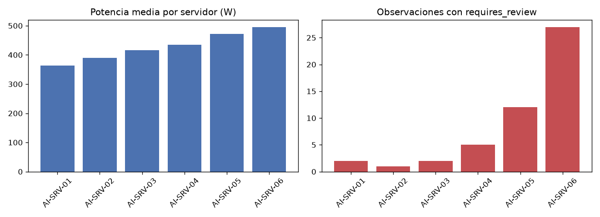

## Tarea 1 - Representar las mediciones

Se cargó `data/server_measurements.csv` (300 filas, con `timestamp` interpretado como datetime) y se implementó la clase `ServerMeasurements`, con `values` como matriz NumPy bidimensional de tipo float64 y `feature_names` como tupla. En la ejecución, las tres validaciones lanzaron `ValueError` como se pedía (matriz no bidimensional, número de columnas distinto de la cantidad de nombres, datos no numéricos) y el caso válido no lanzó error. El `repr` obtenido coincide con el esperado:

```
ServerMeasurements(shape=(300, 3), features=('gpu_utilization', 'cpu_utilization', 'memory_gb'))
```

`build_measurements(df)` seleccionó `gpu_utilization`, `cpu_utilization` y `memory_gb`, en ese orden, las convirtió a flotante y produjo la forma (300, 3).

## Tarea 2 - Normalizar y calcular un indicador de carga

Con operaciones vectorizadas (sin `for` sobre observaciones) se calcularon las medias por columna, [57.9931, 50.5416, 29.4553], que coinciden con las esperadas (diferencia máxima 3.3333e-09), y las desviaciones estándar, [14.4301, 12.6985, 6.5368]; ninguna fue cero (0 casos), y la normalización protege la división por cero. Tras el Z-score, `zscores` tiene forma (300, 3) y `load_score` forma (300,). Cada columna de `zscores` tiene media 0 (máximo |media| = 5.6843e-16) y desviación 1, dentro de la tolerancia 1e-10. `load_score = zscores @ [0.50, 0.30, 0.20]` coincide con la suma ponderada (diferencia máxima 2.2204e-16). Resumen del puntaje: mínimo -1.9556, máximo 3.1362, media 2.6053e-16.

## Tarea 3 - Identificar observaciones para revisión

Se trabajó sobre una copia del DataFrame original, que quedó sin cambios, y se agregaron `load_score` y `requires_review` (tipo bool) con la condición vectorizada `load_score > 1.5` o `temperature_c > 80`. Marcan 49 de las 300 filas, repartidas así: AI-SRV-01: 2, AI-SRV-02: 1, AI-SRV-03: 2, AI-SRV-04: 5, AI-SRV-05: 12, AI-SRV-06: 27. La fila con índice 23 obtenida fue:

| server | timestamp | load_score | temperature_c | requires_review |
|---|---|---|---|---|
| AI-SRV-01 | 2026-08-24 09:55:00 | 3.1362 | 66.97 | True |

El valor medido de `load_score` fue 3.136217861183744, que coincide con el esperado (3.136218).

## Tarea 4 - Construir un resumen por servidor

Agrupando por `server` se obtuvo la tabla con exactamente las columnas exigidas, en este orden: `server`, `observations`, `mean_power_w`, `max_temperature_c`, `mean_load`, `review_count`.

| server | observations | mean_power_w | max_temperature_c | mean_load | review_count |
|---|---|---|---|---|---|
| AI-SRV-01 | 50 | 363.4598 | 86.50 | -0.6145 | 2 |
| AI-SRV-02 | 50 | 390.4990 | 76.47 | -0.4177 | 1 |
| AI-SRV-03 | 50 | 416.6088 | 86.50 | -0.0859 | 2 |
| AI-SRV-04 | 50 | 434.8684 | 80.86 | -0.0030 | 5 |
| AI-SRV-05 | 50 | 471.1808 | 86.50 | 0.4536 | 12 |
| AI-SRV-06 | 50 | 495.7276 | 88.01 | 0.6676 | 27 |

Los totales son consistentes con la Tarea 3: 300 observaciones y 49 filas con revisión. AI-SRV-06 presenta la mayor carga media (0.6676) y concentra 27 de sus 50 observaciones en revisión, mientras que AI-SRV-01 tiene la menor (-0.6145). La fila de AI-SRV-01 reproduce el resultado esperado (363.4598, 86.50, -0.614527, 2).



## Tarea 5 - Guardar y verificar el resultado

El DataFrame analizado de la Tarea 3 (300 filas, 9 columnas) se guardó en `output/server_analysis.parquet` con PyArrow y sin el índice. Al volver a leerlo, la verificación del round trip arrojó:

```
Round trip verificado: output/server_analysis.parquet
Filas: True
Columnas: True
Esquema: True
Valores: True
```

Filas: 300 antes y 300 después; columnas: 9 antes y 9 después; el esquema coincide (server: large_string, timestamp: timestamp[us], gpu_utilization/cpu_utilization/memory_gb/power_w/temperature_c/load_score: double, requires_review: bool) y los valores son iguales antes y después.
