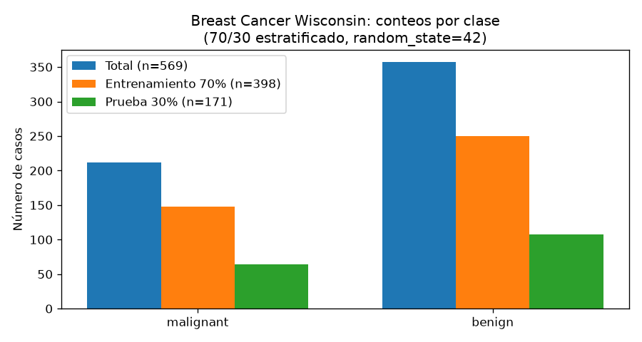
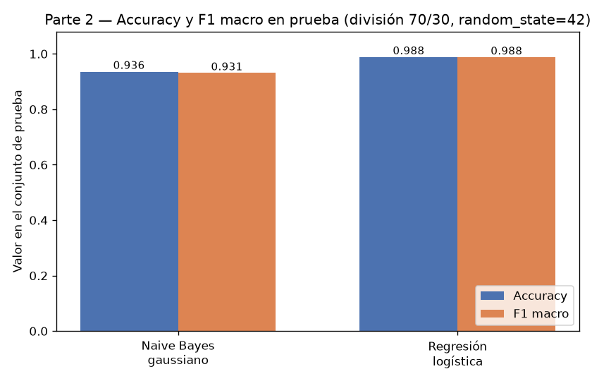
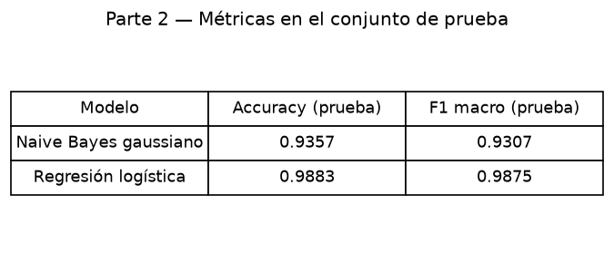
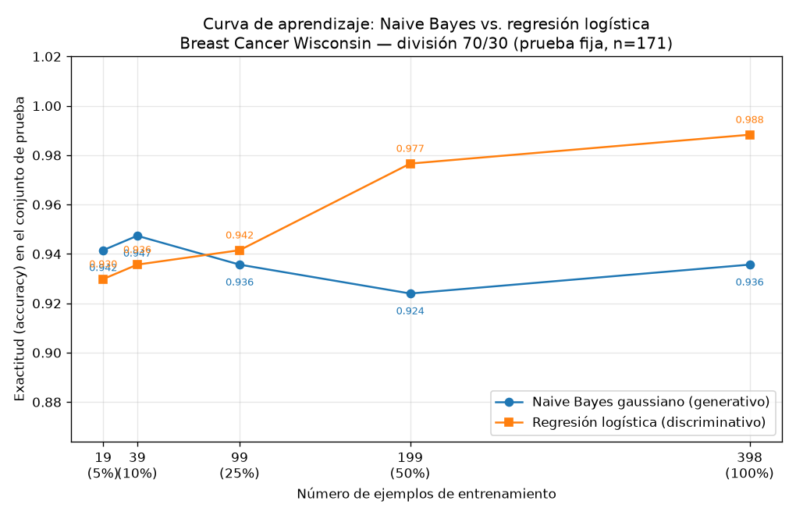

## Introducción

Ng y Jordan (2002) mostraron analíticamente que un clasificador generativo puede alcanzar su error asintótico con menos ejemplos que su par discriminativo, aun cuando ese error asintótico sea mayor. Esta tarea comprueba esa predicción sobre datos reales: se enfrentan un Naive Bayes gaussiano (generativo) y una regresión logística (discriminativa) en el conjunto Breast Cancer Wisconsin (Diagnostic), primero con el entrenamiento completo y luego a lo largo de una curva de aprendizaje, evaluando siempre sobre el mismo conjunto de prueba.

## Metodología

**Datos y división.** Con `sklearn.datasets.load_breast_cancer` se obtuvieron 569 ejemplos con 30 atributos: 212 casos malignant y 357 benign (proporciones 0.3726 y 0.6274). Se creó una única división 70 %/30 % estratificada por clase con `random_state=42`: 398 ejemplos de entrenamiento (148 malignant, 250 benign; proporciones 0.3719 y 0.6281) y 171 de prueba (64 malignant, 107 benign; 0.3743 y 0.6257). La diferencia máxima de proporciones de clase entre entrenamiento y prueba fue 0.0017, lo que verifica la estratificación. El conjunto de prueba no se usó para ajustar nada en toda la tarea.

**Modelos.** Naive Bayes gaussiano (`GaussianNB`, hiperparámetros por defecto) y regresión logística (`LogisticRegression`, `max_iter=5000`, `random_state=42`), sobre atributos estandarizados con `StandardScaler` ajustado solo con el entrenamiento: la media del entrenamiento estandarizado quedó en 7.3197e-16 (≈0) y su desviación estándar en 1 ± 2.2204e-16, mientras que la media del test estandarizado es 0.2060, evidencia de que el test no participó en el ajuste del escalador.

**Curva de aprendizaje.** Sobre la misma división se entrenaron ambos modelos con submuestras estratificadas del 5 %, 10 %, 25 %, 50 % y 100 % del entrenamiento (`random_state=42`), correspondientes a 19, 39, 99, 199 y 398 ejemplos (p. ej., la submuestra de 19 tiene 7 malignant y 12 benign). En cada punto el escalador se reajustó solo con la submuestra correspondiente y la evaluación se hizo siempre sobre el mismo conjunto de prueba de 171 casos. Métricas: accuracy y F1 macro.

## Resultados

Con el entrenamiento completo (398 ejemplos), la regresión logística supera al Naive Bayes en ambas métricas:

| Modelo | Accuracy | F1 macro |
|---|---:|---:|
| Naive Bayes gaussiano | 0.9357 | 0.9307 |
| Regresión logística | 0.9883 | 0.9875 |

En la matriz de confusión, el Naive Bayes comete 11 errores (7 malignos predichos benignos y 4 benignos predichos malignos), frente a 2 errores de la regresión logística (1 y 1).

La curva de aprendizaje, medida siempre sobre la misma prueba, fue:

| n entrenamiento | Accuracy NB | Accuracy RL | F1 macro NB | F1 macro RL |
|---:|---:|---:|---:|---:|
| 19 | 0.9415 | 0.9298 | 0.9353 | 0.9217 |
| 39 | 0.9474 | 0.9357 | 0.9420 | 0.9285 |
| 99 | 0.9357 | 0.9415 | 0.9302 | 0.9363 |
| 199 | 0.9240 | 0.9766 | 0.9180 | 0.9747 |
| 398 | 0.9357 | 0.9883 | 0.9307 | 0.9875 |

El punto de 398 ejemplos coincide exactamente con la tabla de la Parte 2, lo que confirma la consistencia del procedimiento.

## Discusión

El cruce predicho por Ng y Jordan sí se observa. Con 19 ejemplos el Naive Bayes gana por 0.0117 (0.9415 contra 0.9298) y con 39 también por 0.0117 (0.9474 contra 0.9357). Entre 39 y 99 ejemplos ocurre el cruce: con 99 la regresión logística ya supera al Naive Bayes por 0.0058 (0.9415 contra 0.9357), y con 199 y 398 la ventaja crece hasta 0.0526 en ambos puntos (0.9766 contra 0.9240 y 0.9883 contra 0.9357).

La forma de las curvas refleja el compromiso sesgo-varianza. La curva del Naive Bayes es casi plana: entre 19 y 398 ejemplos su accuracy se mueve solo entre 0.9240 y 0.9474, y su F1 macro entre 0.9180 y 0.9420; alcanza su meseta prácticamente desde la submuestra más pequeña, como predice la convergencia más rápida de los modelos generativos. Esa meseta es baja porque su sesgo es alto: la suposición de independencia condicional entre los 30 atributos (muchos de ellos medidas de tamaño y forma fuertemente correlacionadas) y la gaussiana por atributo imponen un piso de error que más datos no corrigen; a cambio, al estimar solo una media y una varianza por atributo y clase, su varianza es baja y 19 ejemplos bastan para estabilizarlo. La pequeña caída en 199 (0.9240) y el regreso a 0.9357 con 398 son fluctuaciones de estimación, no una tendencia.

La regresión logística, en cambio, sube de forma monótona: 0.9298, 0.9357, 0.9415, 0.9766 y 0.9883. Con pocos ejemplos su varianza es mayor (debe ajustar 30 coeficientes conjuntamente mediante optimización) y por eso pierde con 19 y 39 ejemplos; pero su sesgo es menor, porque no impone la independencia condicional y puede explotar las correlaciones entre atributos. Eso le da un error asintótico claramente menor: con el entrenamiento completo alcanza 0.9883 de accuracy y 0.9875 de F1 macro, contra 0.9357 y 0.9307 del generativo.

En términos prácticos, con menos de unos 99 ejemplos conviene el generativo; a partir de 99 (25 % del entrenamiento) conviene el discriminativo, y la brecha se amplía con más datos.

## Conclusiones

Sobre la división 70/30 estratificada de Breast Cancer Wisconsin, los resultados reproducen el patrón de Ng y Jordan: el Naive Bayes gaussiano llega a su meseta con muy pocos ejemplos (ya con 19 logra 0.9415, y su mejor valor en la curva es 0.9474 con 39), pero su error asintótico es mayor (0.9357 de accuracy con 398). La regresión logística parte por debajo con pocos datos (0.9298 con 19), cruza al generativo entre 39 y 99 ejemplos y termina muy por encima (0.9883 de accuracy y 0.9875 de F1 macro). El comportamiento es consistente con un modelo generativo de sesgo alto y varianza baja frente a uno discriminativo de sesgo bajo y varianza alta, que se beneficia de cada ejemplo adicional.
