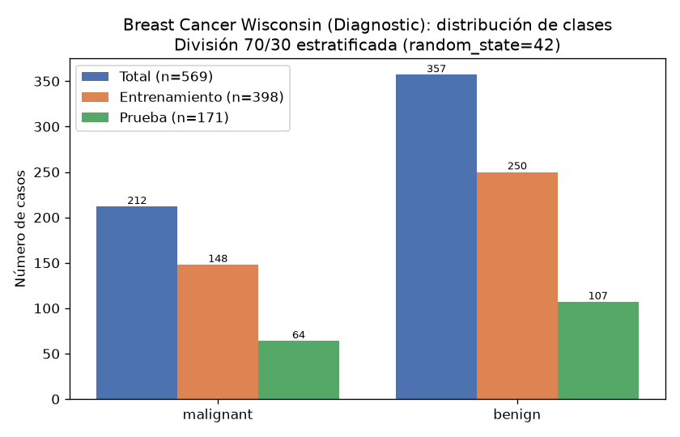
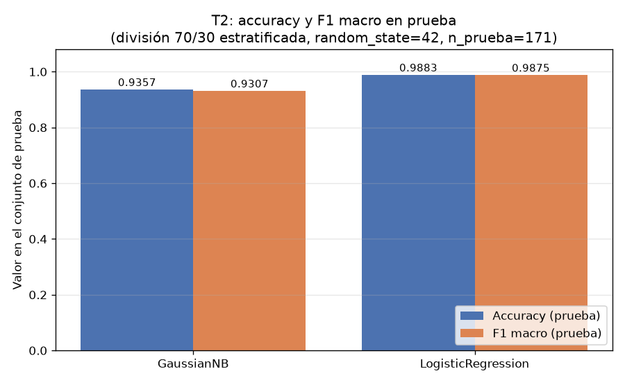
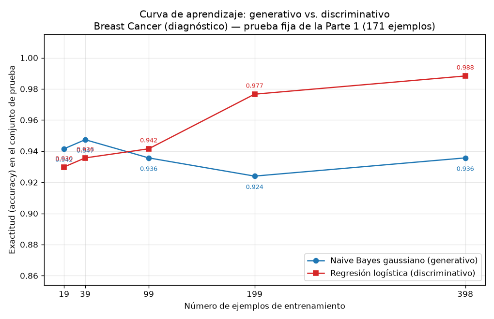

# Generativo contra discriminativo con pocos datos

## Introducción

Ng y Jordan (2002) predijeron que un clasificador generativo alcanza su error asintótico con menos ejemplos que un discriminativo, a costa de un error asintótico mayor. Esta tarea comprueba esa predicción sobre el conjunto Breast Cancer Wisconsin (Diagnostic), comparando un Naive Bayes gaussiano (generativo) con una regresión logística (discriminativa) mediante una curva de aprendizaje sobre una única división entrenamiento/prueba.

## Metodología

Se cargó el conjunto con `sklearn.datasets.load_breast_cancer`: 569 ejemplos, 30 atributos y dos clases, malignant con 212 casos (0.3726) y benign con 357 (0.6274).

La única división usada en toda la tarea fue 70 %/30 % estratificada por clase con `random_state=42`: 398 ejemplos de entrenamiento (148 malignant, 250 benign; proporción de entrenamiento 0.6995) y 171 de prueba (64 malignant, 107 benign; proporción de prueba 0.3005). El conjunto de prueba no se usó para ajustar nada.

Se entrenaron dos modelos: un `GaussianNB` por defecto y una `LogisticRegression` con `max_iter=1000` y `random_state=42`, esta última sobre atributos estandarizados con `StandardScaler` ajustado solo con el entrenamiento (la media del escalador coincide exactamente con la del entrenamiento y difiere de la de la prueba, con diferencia máxima 13.6591, lo que verifica que no hubo fuga de datos).

Para la curva de aprendizaje se reentrenaron ambos modelos con el 5 %, 10 %, 25 %, 50 % y 100 % del entrenamiento (submuestras estratificadas con `random_state=42`, de 19, 39, 99, 199 y 398 ejemplos), reajustando el escalador en cada punto solo con la submuestra correspondiente, y se evaluó siempre sobre el mismo conjunto de prueba de 171 ejemplos. Con el 100 % los resultados reproducen exactamente los de la Parte 2, lo que confirma la consistencia del protocolo.

## Resultados

**Parte 2 — Desempeño con el entrenamiento completo (398 ejemplos):**

| Modelo | Accuracy (prueba) | F1 macro (prueba) |
|---|---:|---:|
| Naive Bayes gaussiano (GaussianNB) | 0.9357 | 0.9307 |
| Regresión logística (LogisticRegression) | 0.9883 | 0.9875 |

Con el entrenamiento completo, la regresión logística supera al Naive Bayes por 0.0526 en accuracy y 0.0569 en F1 macro.

**Parte 3 — Curva de aprendizaje (accuracy sobre el mismo conjunto de prueba):**

| Fracción | n entrenamiento | Accuracy NB | Accuracy RL |
|---:|---:|---:|---:|
| 0.05 | 19 | 0.9415 | 0.9298 |
| 0.10 | 39 | 0.9474 | 0.9357 |
| 0.25 | 99 | 0.9357 | 0.9415 |
| 0.50 | 199 | 0.9240 | 0.9766 |
| 1.00 | 398 | 0.9357 | 0.9883 |

## Discusión

Los datos reproducen el patrón de Ng y Jordan, incluido el cruce. Con muy pocos ejemplos el modelo generativo gana: con 19 ejemplos el Naive Bayes alcanza 0.9415 frente a 0.9298 de la regresión logística, y con 39 ejemplos la brecha se amplía a 0.9474 contra 0.9357. El cruce ocurre entre 39 y 99 ejemplos: con 99, la regresión logística ya supera al Naive Bayes (0.9415 contra 0.9357). A partir de ahí la ventaja discriminativa crece de forma sostenida: con 199 ejemplos la diferencia es 0.0526 (0.9766 contra 0.9240) y con 398 llega a 0.0526 en el punto final medido (0.9883 contra 0.9357), la misma brecha de la Parte 2.

La forma de las curvas confirma la segunda mitad de la predicción. La curva del Naive Bayes es casi plana: parte de 0.9415 con 19 ejemplos, toca su máximo de 0.9474 con 39 y luego se estabiliza alrededor de 0.9357 (incluso baja a 0.9240 con 199). Es decir, converge muy rápido a su error asintótico, pero ese error asintótico es peor: nunca supera 0.9474. La regresión logística, en cambio, parte por debajo (0.9298) pero mejora monótonamente hasta 0.9883, un techo claramente superior.

Esta dinámica se explica por sesgo y varianza. El Naive Bayes gaussiano impone un sesgo fuerte: asume que los 30 atributos son condicionalmente independientes dada la clase, algo falso en este conjunto, donde atributos como mean radius, mean perimeter y mean area están fuertemente correlacionados. Ese sesgo alto limita su error asintótico, pero a cambio reduce la varianza: con 19 ejemplos ya estima 30 medias y 30 varianzas por clase de forma suficientemente estable, y por eso su curva es plana y competitiva desde el inicio. La regresión logística tiene sesgo menor, porque no impone independencia y aprende la frontera lineal directamente, pero paga con mayor varianza: debe estimar 30 coeficientes más el intercepto ajustando la verosimilitud condicional, lo que exige más datos. Con 19 o 39 ejemplos esa varianza la perjudica; con 199 o más, su menor sesgo domina y supera al generativo.

En términos prácticos: con menos de unos 99 ejemplos conviene el Naive Bayes; con 99 o más conviene la regresión logística, y su ventaja se acrecienta con más datos. El conjunto de prueba, fijo y nunca usado para ajustar, garantiza que esta comparación sea justa en todos los tamaños.

## Conclusiones

Sobre Breast Cancer Wisconsin con una división 70/30 estratificada (398/171), la regresión logística con entrenamiento completo logra 0.9883 de accuracy y 0.9875 de F1 macro, frente a 0.9357 y 0.9307 del Naive Bayes gaussiano. La curva de aprendizaje muestra el cruce predicho por Ng y Jordan: el generativo es superior con 19 y 39 ejemplos (0.9415 y 0.9474 contra 0.9298 y 0.9357), el cruce ocurre entre 39 y 99 ejemplos, y el discriminativo domina desde 99 en adelante hasta 0.9883. El Naive Bayes converge rápido a un error asintótico mayor por su alto sesgo (independencia condicional) y baja varianza; la regresión logística converge más lento, por su mayor varianza, pero a un error asintótico menor por su menor sesgo. El experimento confirma cualitativamente la teoría en datos reales.
