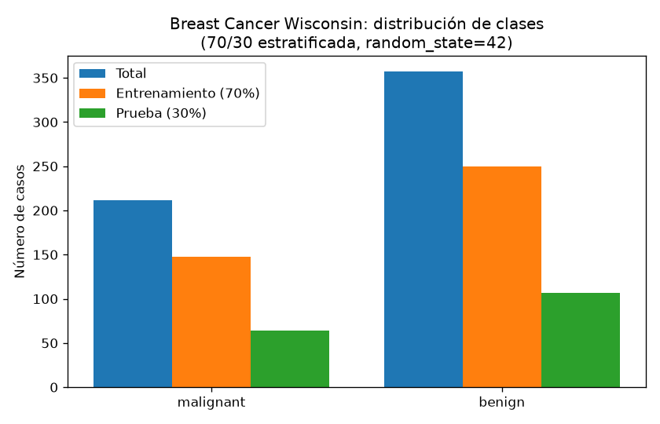
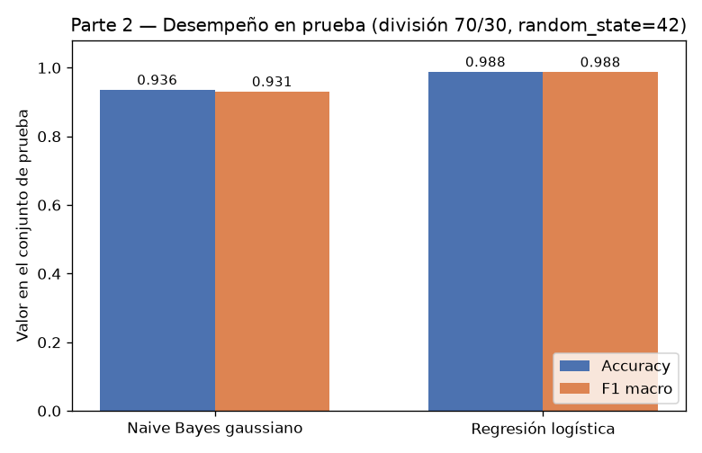
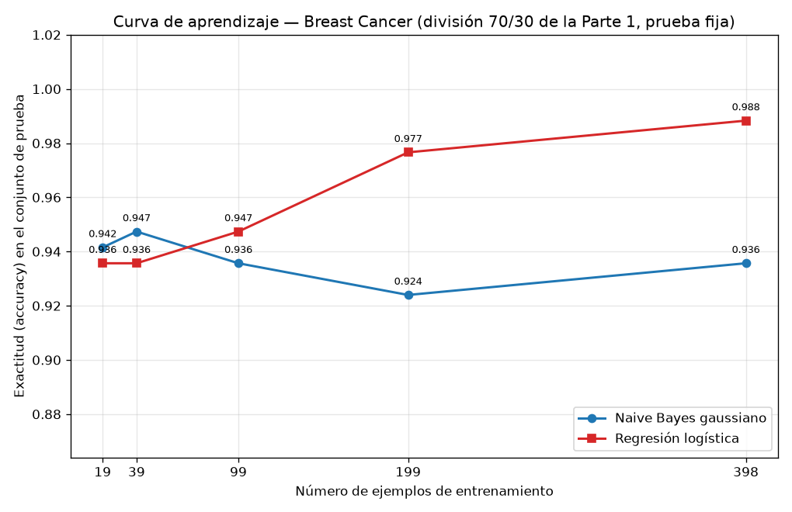

## Introducción

Ng y Jordan (2002) predijeron que un clasificador generativo alcanza su error asintótico con menos ejemplos que uno discriminativo, aunque ese error asintótico sea peor. Esta tarea comprueba esa predicción sobre el conjunto Breast Cancer Wisconsin (Diagnostic) de scikit-learn, enfrentando un Naive Bayes gaussiano (generativo) contra una regresión logística (discriminativa) en una curva de aprendizaje sobre una única división entrenamiento/prueba. Todas las cifras de este reporte provienen de la ejecución del código entregado.

## Metodología

**Datos y división.** Se cargó `load_breast_cancer`: 569 ejemplos, 30 atributos y dos clases, malignant (212 casos) y benign (357 casos). Se dividió 70 %/30 % estratificando por clase con `random_state=42`, lo que produjo 398 ejemplos de entrenamiento (fracción 0.6995; 148 malignant y 250 benign) y 171 de prueba (fracción 0.3005; 64 malignant y 107 benign). Esta división es la única usada en toda la tarea: el conjunto de prueba nunca se empleó para ajustar nada.

**Modelos.** Se entrenaron un `GaussianNB` y una `LogisticRegression` (`max_iter=1000`, `random_state=42`), ambos sobre atributos estandarizados con `StandardScaler` ajustado solo con el entrenamiento; la verificación del código muestra que la media del escalador coincide exactamente con la media del entrenamiento (diferencia 0.0) y difiere de la de prueba.

**Curva de aprendizaje.** Sobre la misma división, se reentrenaron ambos modelos con submuestras estratificadas del entrenamiento (`random_state=42`) de 5 %, 10 %, 25 %, 50 % y 100 %, es decir, 19, 39, 99, 199 y 398 ejemplos, y se evaluó la exactitud siempre sobre el mismo conjunto de prueba de 171 ejemplos. El escalador se ajustó una sola vez con el entrenamiento completo y las submuestras se tomaron sobre los atributos ya estandarizados, de modo que la prueba transformada es idéntica en todos los puntos.

## Resultados

**Parte 2 — Desempeño con el entrenamiento completo (398 ejemplos), sobre la prueba:**

| Modelo | Accuracy | F1 macro |
|---|---|---|
| Naive Bayes gaussiano | 0.9357 | 0.9307 |
| Regresión logística | 0.9883 | 0.9875 |

La regresión logística gana en ambas métricas con el entrenamiento completo.

**Parte 3 — Curva de aprendizaje (exactitud sobre la misma prueba):**

| n entrenamiento | Fracción | NB gaussiano | Regresión logística | Mejor |
|---|---|---|---|---|
| 19 | 0.05 | 0.9415 | 0.9357 | NB |
| 39 | 0.10 | 0.9474 | 0.9357 | NB |
| 99 | 0.25 | 0.9357 | 0.9474 | RL |
| 199 | 0.50 | 0.9240 | 0.9766 | RL |
| 398 | 1.00 | 0.9357 | 0.9883 | RL |

El Naive Bayes gana con 19 y 39 ejemplos; la regresión logística gana a partir de 99 ejemplos. La curva del Naive Bayes es casi plana: parte de 0.9415 con 19 ejemplos y termina en 0.9357 con 398, con máximo de 0.9474 en 39. La regresión logística crece de forma monótona: 0.9357 con 19 y 39 ejemplos, 0.9474 con 99, 0.9766 con 199 y 0.9883 con 398.

## Discusión

**El cruce de Ng y Jordan sí se observa.** Con muy pocos datos el modelo generativo es mejor: con 19 ejemplos el Naive Bayes alcanza 0.9415 frente a 0.9357 de la regresión logística, y con 39 ejemplos la brecha se amplía a 0.9474 contra 0.9357. El cruce ocurre entre 39 y 99 ejemplos (entre el 10 % y el 25 % del entrenamiento): con 99 la regresión logística ya supera al Naive Bayes (0.9474 contra 0.9357) y la brecha sigue creciendo hasta 0.9883 contra 0.9357 con los 398 ejemplos. Esto reproduce el patrón teórico: el generativo converge pronto a su asíntota, el discriminativo necesita más datos pero converge a un error menor.

**Sesgo y varianza.** El Naive Bayes gaussiano tiene sesgo alto: asume independencia entre atributos condicional a la clase, algo claramente falso aquí, donde atributos como mean radius, mean perimeter y mean area son versiones casi lineales del mismo tamaño del tumor. Ese sesgo fija su techo: por eso su curva es plana y su exactitud con 398 ejemplos (0.9357) es prácticamente la misma que con 19 (0.9415). A cambio, su varianza es baja: estima medias y varianzas por atributo de forma independiente, con pocos parámetros por clase, así que con solo 19 ejemplos (7 malignant y 12 benign) ya produce un clasificador estable. La regresión logística tiene sesgo menor (no impone independencia y aprende correlaciones entre atributos mediante los coeficientes), pero varianza mayor: debe estimar 30 coeficientes conjuntamente, y con 7 ejemplos de la clase minoritaria su estimación es pobre, lo que explica su arranque plano en 0.9357 con 19 y 39 ejemplos. Al crecer n, la varianza se reduce y su menor sesgo domina: la mejora es monótona y alcanza 0.9883.

**Matices.** El Naive Bayes muestra una caída en n=199 (0.9240) y no es estrictamente monótono; con una sola submuestra fija por punto y una prueba de 171 ejemplos, esas oscilaciones pequeñas son compatibles con un modelo ya asentado cerca de su asíntota. En cambio, la tendencia de la regresión logística es inequívoca. En términos prácticos: con menos de unos 40 ejemplos conviene el generativo; con 99 o más conviene el discriminativo, y la diferencia se hace grande con datos suficientes.

## Conclusiones

Los resultados confirman cualitativamente a Ng y Jordan sobre datos reales. Con el entrenamiento completo, la regresión logística es superior (accuracy 0.9883 y F1 macro 0.9875, contra 0.9357 y 0.9307 del Naive Bayes gaussiano), es decir, tiene mejor error asintótico. Pero en régimen de pocos datos el generativo gana: con 19 y 39 ejemplos (5 % y 10 % del entrenamiento) el Naive Bayes supera a la regresión logística, y su curva casi plana muestra que alcanza su desempeño asintótico con muy pocos ejemplos. El cruce ocurre entre 39 y 99 ejemplos. La explicación por sesgo y varianza es consistente: el generativo paga un sesgo alto (independencia condicional violada en estos atributos altamente correlacionados) a cambio de una varianza baja que lo hace eficiente con pocos datos; el discriminativo tiene menor sesgo pero requiere más ejemplos para controlar su varianza, y cuando los tiene, lo supera claramente. Para este problema, la recomendación depende del presupuesto de datos: pocas etiquetas, Naive Bayes; datos suficientes, regresión logística.
