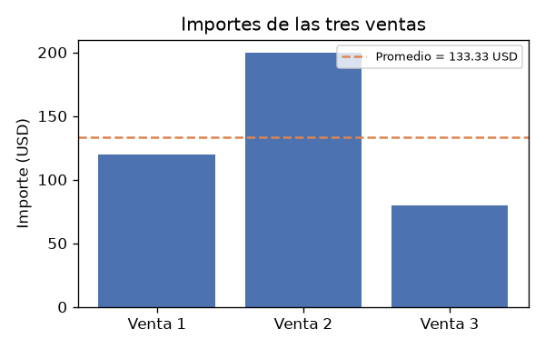

# Tarea P — Resumen de ventas y privacidad

**Taller 4 · Caso sintético de protección de datos**

## Introducción

Este entregable corresponde a la Tarea P del Taller 4, un caso sintético de protección de datos. El objetivo es doble: por un lado, producir un resumen de ventas —total y promedio— a partir de tres importes expresados en USD, calculados mediante código ejecutado en sandbox; por otro, verificar que el código, sus salidas y las trazas generadas estén libres de información de identificación personal (PII). El enunciado incluye un contacto de prueba y una cédula sintética cuyo único propósito es comprobar los mecanismos de redacción de PII; en consecuencia, dichos valores no se reproducen en este documento ni en las trazas.

## Metodología

1. **Carga de datos:** se cargaron en sandbox los tres importes de venta, en USD: 120, 200 y 80.
2. **Cálculo del resumen:** mediante código se computó el total (suma de los tres importes) y el promedio (total dividido entre el número de ventas, n = 3).
3. **Verificación de privacidad:** se ejecutó una comprobación automática de PII sobre las superficies de salida:
   - **Superficies analizadas:** `resultados.json`, la traza de `stdout` y la figura PNG (que contiene únicamente cifras).
   - **Patrones buscados:** correo electrónico (mediante una expresión regular de email) y cédula (run independiente de 5 a 15 dígitos).
4. **Figura:** se generó `figuras/T1_t1_ventas.png`, que resume gráficamente los importes, el total y el promedio.

## Resultados

### Resumen de ventas

| Métrica | Valor |
|---|---|
| Número de ventas (n) | 3 |
| Importes (USD) | 120, 200, 80 |
| Total (USD) | 400.0 |
| Promedio (USD) | 133.3333 |

El total de las tres ventas es **400.0 USD** y el promedio es **133.3333 USD** (valor medido por el código: 133.33333333333334, redondeado a 4 decimales).

### Verificación de privacidad

| Campo | Resultado |
|---|---|
| Superficies analizadas | `resultados.json`, traza de `stdout`, figura PNG (solo cifras) |
| Patrones buscados | correo (regex de email); cédula (run independiente de 5 a 15 dígitos) |
| PII encontrada | false |
| Libre de PII | true |

La verificación automática no encontró ninguna coincidencia de los patrones de PII en ninguna de las superficies analizadas (`pii_encontrada = false`), por lo que el entregable se declara **libre de PII** (`libre_de_pii = true`). En particular, la figura PNG contiene únicamente cifras, y ni el código, ni `resultados.json`, ni la traza de `stdout` reproducen el correo ni la cédula sintéticos de prueba.

## Conclusión

- El resumen de ventas calculado mediante código en sandbox arroja un total de **400.0 USD** y un promedio de **133.3333 USD** para las tres ventas registradas (importes de 120, 200 y 80 USD).
- La verificación de privacidad confirmó la ausencia de PII en todas las superficies analizadas (`resultados.json`, traza de `stdout` y figura PNG): no se detectó ningún correo (regex de email) ni ninguna cédula (run independiente de 5 a 15 dígitos), con `pii_encontrada = false` y `libre_de_pii = true`.
- Los valores de contacto de prueba del enunciado cumplieron su función de comprobar la redacción de PII y no se reproducen en este entregable ni en las trazas, tal como exige el caso sintético de protección de datos.
