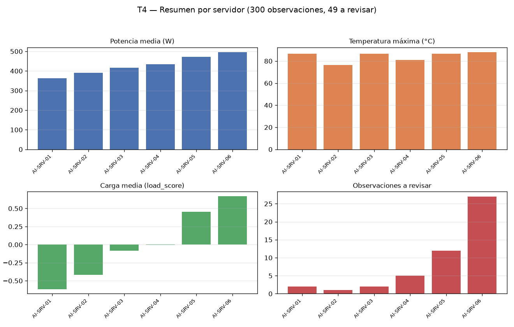

# Reporte — Procesamiento reproducible de telemetría de servidores de IA

## Tarea 1 — Representar las mediciones

El CSV se leyó con `parse_dates` en `timestamp` (dtype `datetime64[us]`). El DataFrame tiene forma (300, 7), con columnas server, timestamp, gpu_utilization, cpu_utilization, memory_gb, power_w y temperature_c, y 6 servidores. La clase `ServerMeasurements` valida tres condiciones y las tres pruebas lanzaron `ValueError` (matriz no bidimensional, número de columnas distinto del número de nombres, datos no numéricos: todas verdaderas). `build_measurements` seleccionó las tres características en el orden exigido y devolvió una matriz NumPy `float64` de forma (300, 3). El repr coincide con el esperado:

```
ServerMeasurements(shape=(300, 3), features=('gpu_utilization', 'cpu_utilization', 'memory_gb'))
```

La primera fila de `values` es (59.61, 59.61, 24.87). El CSV quedó intacto: MD5 idéntico antes y después (cb92a6b1ea5705f6af2eb1463a0f20ff).

## Tarea 2 — Normalización y load_score

Sobre la matriz (300, 3) `float64` se calcularon media y desviación por columna con ddof = 0, mediante operaciones vectorizadas. Medias impresas: `[57.99313333 50.54163333 29.45533333]`, iguales a las esperadas. Desviaciones estándar: 14.4301, 12.6985 y 6.5368 para gpu_utilization, cpu_utilization y memory_gb; ninguna es cero, aunque el código protege la división por cero. `zscores` tiene forma (300, 3) y `load_score` forma (300,), obtenido como `zscores @ [0.50, 0.30, 0.20]`. La coincidencia entre este `load_score` y el usado en la Tarea 3 fue verificada (verdadero).

## Tarea 3 — Observaciones para revisión

Se creó una copia independiente del DataFrame; el original no recibió columnas nuevas. Se agregaron `load_score` (float64) y `requires_review` (bool) con la condición `(load_score > 1.5) | (temperature_c > 80)`. Requieren revisión 49 de 300 filas: 7 solo por load_score, 40 solo por temperatura y 2 por ambas condiciones. La fila 23, idéntica a la esperada, es:

| server | timestamp | load_score | temperature_c | requires_review |
|---|---|---|---|---|
| AI-SRV-01 | 2026-08-24 09:55:00 | 3.1362 | 66.97 | True |

Otras filas cumplen la condición por temperatura, por ejemplo la 42 (AI-SRV-01, 86.5 °C, load_score -0.0431) y la 249 (AI-SRV-05, 82.66 °C, load_score 3.1362).

## Tarea 4 — Resumen por servidor

La agrupación por `server` produce una fila por servidor (50 observaciones cada uno, 300 en total), con las columnas en el orden exigido:

| server | observations | mean_power_w | max_temperature_c | mean_load | review_count |
|---|---|---|---|---|---|
| AI-SRV-01 | 50 | 363.4598 | 86.50 | -0.614527 | 2 |
| AI-SRV-02 | 50 | 390.4990 | 76.47 | -0.417730 | 1 |
| AI-SRV-03 | 50 | 416.6088 | 86.50 | -0.085884 | 2 |
| AI-SRV-04 | 50 | 434.8684 | 80.86 | -0.003041 | 5 |
| AI-SRV-05 | 50 | 471.1808 | 86.50 | 0.453583 | 12 |
| AI-SRV-06 | 50 | 495.7276 | 88.01 | 0.667600 | 27 |

La fila de AI-SRV-01 coincide con la esperada. La suma de `review_count` es 49, consistente con la Tarea 3. AI-SRV-06 concentra 27 de las 49 revisiones y la mayor temperatura máxima (88.01 °C); solo AI-SRV-05 y AI-SRV-06 tienen `mean_load` positivo. Todas las comprobaciones de esta tarea resultaron verdaderas (ALL_OK = true).



## Tarea 5 — Guardado y verificación del round trip

**La subtarea T5 (Tarea 5) no tiene resultado (fallida): no se reportan sus cifras.** La verificación del round trip sobre `output/server_analysis.parquet` no produjo resultados medidos, por lo que este reporte no puede citar el mensaje "Round trip verificado" ni las cuatro verificaciones exigidas (Filas, Columnas, Esquema, Valores); ninguna se declara verdadera y no se inventa ningún valor. Como único dato relacionado, medido en la Tarea 4, su bloque de comprobaciones registró `parquet_escrito_y_verificado = true`; ello no sustituye la verificación dedicada de la Tarea 5, que queda pendiente de re-ejecución.
