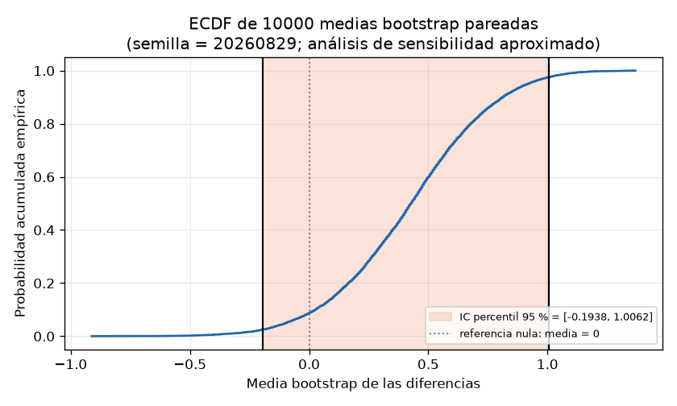

# Informe — Comparación defendible de dos modelos sobre tiendas pareadas

Ejercicio de refuerzo · Semana 2 · Matemáticas y Programación para IA

## Parte 1. Contrato de análisis previo

**1. ¿Qué dos modelos se comparan?**
Se comparan los modelos de regresión A y B, ya entrenados, que pronostican la demanda semanal de las mismas 16 tiendas. Los datos provienen de `data/model_errors.csv` (columnas `store_id`, `error_a`, `error_b`) y contienen el error absoluto de cada modelo en unidades vendidas.

**2. ¿Qué población o proceso objetivo propone para interpretar el ejercicio?**
Propongo como proceso objetivo el mecanismo que genera pares de errores de pronóstico (error_a, error_b) cuando dos modelos miden la misma unidad: un proceso de comparación pareada sobre tiendas comparables. Lo que impide afirmar que los datos representan realmente esa población es su procedencia: son sintéticos, deterministas y creados para la actividad; no provienen de tiendas reales ni de un muestreo aleatorio de una población existente, por lo que no constituyen evidencia sobre una empresa, mercado o población.

**3. ¿Cuál es la métrica principal y qué dirección representa un mejor resultado?**
La métrica principal es el error absoluto de pronóstico en unidades vendidas. Un valor menor es un mejor resultado; en la diferencia por tienda, un valor positivo favorece a B y uno negativo favorece a A.

**4. ¿Cuál es la unidad de análisis?**
La tienda pareada: cada `store_id` con su par de errores medido sobre los mismos datos.

**5. ¿Por qué las observaciones están emparejadas y cómo verificará los pares?**
Están emparejadas porque ambos modelos pronostican exactamente las mismas 16 tiendas; cada fila aporta dos mediciones sobre la misma unidad. Verificaré los pares mediante la clave `store_id` — única y no nula — con un cruce uno a uno y la comparación de las filas reconstruidas contra las originales; comprobar solo la longitud de los vectores no demuestra la correspondencia.

**6. Defina el estimando y la diferencia por tienda.**
El estimando es Δ = E(d_i), con d_i = e_A(i) − e_B(i) por tienda. Una diferencia positiva significa que el error absoluto de A excede al de B en esa tienda, es decir, que B pronostica mejor allí; una diferencia negativa favorece a A.

**7. Hipótesis.**
H0: Δ = 0 (la media de las diferencias es cero). H1: Δ ≠ 0 (alternativa bilateral).

**8. ¿Cuál será el procedimiento principal y qué supuestos requiere?**
Prueba t de una muestra sobre el vector de diferencias, bilateral. Requiere pares independientes entre tiendas, diferencias en escala continua y aproximadamente normales (o n suficiente para la aproximación t), y que la media de las diferencias resuma el efecto de interés.

**9. ¿Qué resultados reportará además del p-value?**
n, media, desviación estándar muestral y error estándar de las diferencias; estadístico t, grados de libertad e intervalo t bilateral del 95 %; conteo de tiendas que favorecen a cada modelo con la figura por tienda; e intervalo bootstrap percentil del 95 % como sensibilidad.

**10. ¿Qué afirmaciones no permite realizar este diseño?**
No permite afirmar causalidad ni generalizar a tiendas, mercados o poblaciones reales (los datos son sintéticos); no permite interpretar el p-value como la probabilidad de que H0 sea verdadera; no permite concluir igualdad de los modelos a partir de un resultado no significativo; y no permite inferir sobre tiendas no observadas.

## Parte 2. Auditoría y evidencia por tienda

**11. Confirmación de los 16 pares validados mediante store_id.**
La auditoría de `data/model_errors.csv` confirmó: columnas exactas `store_id`, `error_a`, `error_b`; `store_id` único y no nulo; errores numéricos, finitos y no negativos; y 16 pares. El archivo no fue modificado: el hash SHA-256 es idéntico antes y después (`cdd1af7ad3a6ee8f49a14f48ea2d8347591e85388a222b2a83b9d661ae95d7a2`). El emparejamiento se verificó por `store_id` mediante un merge uno-a-uno y la comparación de las filas reconstruidas con las originales.

Comprobar únicamente la longitud es insuficiente: que `len(error_a) == len(error_b)` solo confirma el número de valores, no su correspondencia. La auditoría lo demostró empíricamente: tras permutar `error_b` las longitudes permanecen iguales mientras las diferencias cambian, porque cada error dejaría de pertenecer a su tienda. La clave `store_id` es la que garantiza el emparejamiento.

Tabla pareada (16 filas; `difference = error_a − error_b`; `favors`: "B" si difference > 0, "A" si difference < 0):

| store_id | error_a | error_b | difference | favors |
|---|---|---|---|---|
| S01 | 12.4 | 10.6 | 1.8 | B |
| S02 | 9.8 | 9.1 | 0.7 | B |
| S03 | 15.1 | 13.9 | 1.2 | B |
| S04 | 11.0 | 12.4 | -1.4 | A |
| S05 | 8.7 | 7.2 | 1.5 | B |
| S06 | 13.6 | 13.9 | -0.3 | A |
| S07 | 10.2 | 9.3 | 0.9 | B |
| S08 | 14.9 | 12.8 | 2.1 | B |
| S09 | 7.5 | 9.3 | -1.8 | A |
| S10 | 16.0 | 15.0 | 1.0 | B |
| S11 | 9.3 | 9.8 | -0.5 | A |
| S12 | 12.8 | 11.1 | 1.7 | B |
| S13 | 11.7 | 12.9 | -1.2 | A |
| S14 | 8.9 | 8.3 | 0.6 | B |
| S15 | 13.2 | 11.9 | 1.3 | B |
| S16 | 10.6 | 11.5 | -0.9 | A |

**12. Tiendas que favorecen a cada modelo.**
10 tiendas favorecen a B: S01, S02, S03, S05, S07, S08, S10, S12, S14, S15. 6 tiendas favorecen a A: S04, S06, S09, S11, S13, S16. No hay empates (0). La diferencia de mayor magnitud que favorece a B es S08 con 2.1 unidades; la de mayor magnitud que favorece a A es S09 con −1.8 unidades. La figura `output/store_differences.png` muestra las 16 tiendas como barras divergentes con el signo y la magnitud de `difference` y una línea de referencia visible en cero (azul: favorece a B; rojo: favorece a A); en ella se aprecia que las barras hacia B dominan, pero varias tiendas presentan diferencias negativas de magnitud comparable, como S09 con −1.8.

## Parte 3. Efecto e incertidumbre

**13. Descriptivos de las diferencias.**

| Cantidad | Valor |
|---|---|
| n | 16 |
| Media | 0.4187 |
| Desviación estándar muestral | 1.2534 |
| Error estándar | 0.3133 |

El signo de la media es positivo: en promedio, el error absoluto de A excede al de B en 0.4187 unidades vendidas por tienda, es decir, el efecto puntual favorece a B. La desviación muestral (1.2534) describe la dispersión del efecto entre tiendas — las diferencias van de −1.8 a 2.1, con mediana 0.8 — y no disminuye al aumentar n. El error estándar (0.3133 = 1.2534/√16) es la incertidumbre de la media y sí decrece como sd/√n. Confundirlos sería tratar la heterogeneidad entre tiendas como si fuera incertidumbre de la media, o viceversa.

**14. Intervalo t del 95 %.**
El intervalo t bilateral del 95 % para la media pareada, con 15 grados de libertad y valor crítico 2.1314, es [−0.2491, 1.0866]. Bajo el modelo t utilizado, los valores del efecto compatibles con los datos van de −0.2491 a 1.0866 unidades vendidas; el intervalo contiene 0, de modo que un efecto nulo es compatible con los datos. El intervalo no es una probabilidad posterior sobre Δ: en este marco el parámetro no es aleatorio; la cobertura del 95 % se refiere al comportamiento del procedimiento en muestreos repetidos bajo el modelo y sus supuestos.

## Parte 4. Referencias nulas y sensibilidad

**15. Prueba t pareada.**
Sobre las diferencias, la prueba t de una muestra bilateral produce: estadístico t = 1.3364, grados de libertad = 15, p-value bilateral = 0.2013.

El p-value se interpreta de forma condicional a la hipótesis nula, el diseño y los supuestos: si H0 (Δ = 0) fuera cierta, y bajo el emparejamiento por tienda, la independencia entre pares y la aproximación t con 15 grados de libertad, la probabilidad de observar un estadístico t al menos tan extremo como 1.3364 en cualquier dirección es 0.2013. No es la probabilidad de que H0 sea verdadera ni la de que el resultado se deba al azar.

**16. Referencia exacta por cambios de signo.**

> **Declaración:** la subtarea T5 (Tarea 5, Parte 4) no tiene resultado (fallida): no se reportan sus cifras. El total de configuraciones extremas y el p-value exacto por cambios de signo no están disponibles en este informe.

El procedimiento diseñado enumeraba las 2^16 = 65 536 configuraciones de signos del vector de diferencias y contaba cuántas medias nulas tienen magnitud al menos tan extrema como la observada; al no ejecutarse con éxito, no se reportan el conteo de extremas ni el p-value.

Aunque ambas referencias evalúan H0: Δ = 0, no son intercambiables: la prueba t usa las magnitudes de las diferencias y su referencia nula proviene de la distribución t bajo normalidad (aproximada con 15 grados de libertad); la prueba por cambios de signo usa solo los signos y construye su referencia nula por enumeración exacta, suponiendo que bajo H0 cada diferencia es simétrica respecto de 0 (flippear su signo es igual de probable), sin suponer normalidad. Difieren en estadístico, supuestos y distribución nula; p-values numéricamente cercanos no las harían equivalentes, y su sensibilidad ante colas y valores atípicos es distinta.

**17. Bootstrap pareado.**
Con `np.random.default_rng(20260829)` y 10 000 remuestras se remuestrearon tiendas completas (filas del vector de diferencias) y se calculó la media de cada remuestra. El intervalo percentil del 95 % es [−0.1938, 1.0062], de longitud 1.2, y contiene 0. La reproducibilidad se verificó: dos ejecuciones con la misma semilla produjeron intervalos idénticos. Resumen de la distribución bootstrap: media 0.4210, error estándar 0.3056, sesgo frente a la media observada 0.0022, mediana 0.425, mínimo −0.9125, máximo 1.3688.

Se remuestrean tiendas completas porque la unidad independiente de análisis es el par: cada tienda aporta (error_a, error_b) medidos sobre los mismos datos, y la correlación dentro del par solo se preserva si la fila se remuestrea como unidad. Remuestrear error_a y error_b por separado rompería el emparejamiento, mezclaría errores de tiendas distintas y respondería a la pregunta de dos muestras independientes. El bootstrap no puede corregir automáticamente sesgos de selección o falta de representatividad de las 16 tiendas, dependencias entre tiendas ni errores de medición sistemáticos compartidos por ambos modelos: solo genera variabilidad a partir de la muestra observada, y con n = 16 los extremos dependen de pocos puntos.

Como sensibilidad aproximada, el intervalo bootstrap [−0.1938, 1.0062] es cercano al intervalo t [−0.2491, 1.0866]; ambos contienen 0, de modo que ninguna de las dos referencias descarta un efecto nulo.

## Parte 5. Informe ejecutivo

**18. Informe ejecutivo (máximo 150 palabras).**

Unidad: 16 tiendas pareadas. Procedencia: datos sintéticos y deterministas (`data/model_errors.csv`); no representan tiendas reales. Métrica: error absoluto en unidades vendidas; menor es mejor. Emparejamiento: ambos modelos pronostican las mismas tiendas; pares verificados por `store_id`. Efecto: media de d = error_a − error_b = 0.4187 unidades, favorable a B. Incertidumbre: desviación muestral 1.2534; error estándar 0.3133; intervalo t del 95 % [−0.2491, 1.0866]. Procedimiento: prueba t de una muestra bilateral sobre las diferencias; p-value = 0.2013, que no es la probabilidad de que H0 sea verdadera. Sensibilidad: bootstrap pareado (semilla 20260829; 10 000 remuestras), intervalo percentil [−0.1938, 1.0062]; ambos intervalos contienen 0. Limitaciones: n = 16 con datos sintéticos sin muestreo real, y el diseño pareado no establece causalidad. No puede concluirse que B supere a A en una población real ni que ambos modelos sean equivalentes; solo que, en estas 16 tiendas, la evidencia no es concluyente.

> **Declaración:** la subtarea T7 (Tarea 7, Parte 5) no tiene resultado (omitida): no se reportan sus cifras. Los artefactos `output/store_differences.csv` y `output/store_differences.png` provienen de las subtareas T2 y T3.
