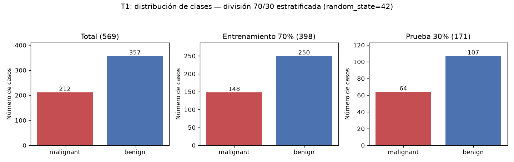
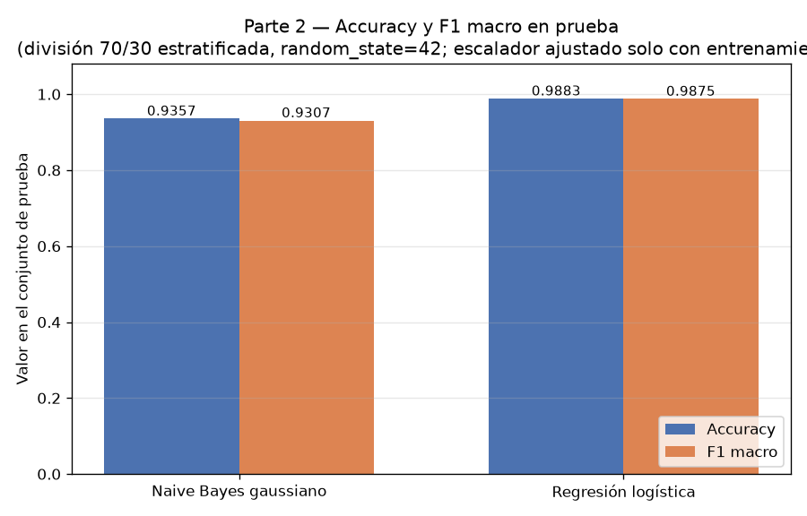
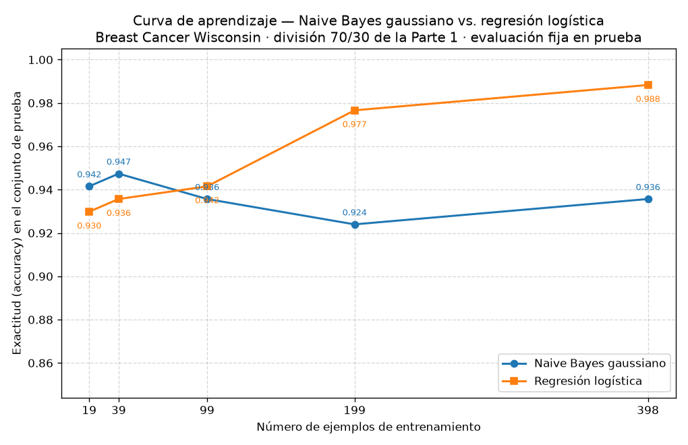

## Introducción

Ng y Jordan (2002) mostraron teóricamente que un clasificador generativo (Naive Bayes) alcanza su error asintótico con menos ejemplos que un clasificador discriminativo (regresión logística), aunque dicho error asintótico sea mayor. Esta tarea comprueba esa predicción sobre datos reales del conjunto Breast Cancer Wisconsin (Diagnostic): se comparan ambos modelos sobre una única división entrenamiento/prueba, primero con el entrenamiento completo y después con submuestras del 5 % al 100 %, para localizar el cruce entre sus curvas de aprendizaje.

## Metodología

**Datos.** Con `sklearn.datasets.load_breast_cancer` se obtuvieron 569 ejemplos con 30 atributos, con 212 casos malignant (proporción 0.3726) y 357 casos benign (proporción 0.6274). La distribución de clases se muestra en la figura 1.

**División.** Se creó una única división 70 %/30 % estratificada por clase con `random_state=42`: 398 ejemplos de entrenamiento (148 malignant, 250 benign) y 171 de prueba (64 malignant, 107 benign). La estratificación fue verificada: la proporción de clases de cada partición difiere de la del total a lo sumo en 0.0017. El conjunto de prueba no se usó para ajustar nada (ni escalador, ni modelos, ni selección de atributos).

**Modelos.** Se entrenó un Naive Bayes gaussiano (`GaussianNB`, parámetros por defecto) y una regresión logística (`LogisticRegression(max_iter=5000, random_state=42)`), ambos sobre atributos estandarizados con `StandardScaler` ajustado únicamente con el entrenamiento (en la Parte 3, con cada submuestra). Se midió exactitud (accuracy) y F1 macro sobre el conjunto de prueba.

**Curva de aprendizaje.** Sobre la misma división, se entrenaron ambos modelos con el 5 %, 10 %, 25 %, 50 % y 100 % del entrenamiento (submuestras estratificadas, `random_state=42`), lo que corresponde a 19, 39, 99, 199 y 398 ejemplos, evaluando siempre sobre los mismos 171 ejemplos de prueba.

## Resultados

La tabla 1 resume la Parte 2, con el entrenamiento completo (398 ejemplos).

| Modelo | Accuracy (prueba) | F1 macro (prueba) |
|---|---|---|
| Naive Bayes gaussiano | 0.9357 | 0.9307 |
| Regresión logística | 0.9883 | 0.9875 |

La tabla 2 y la figura 2 presentan la curva de aprendizaje (Parte 3).

| n entrenamiento (fracción) | Accuracy NB gaussiano | Accuracy reg. logística |
|---|---|---|
| 19 (0.05) | 0.9415 | 0.9298 |
| 39 (0.10) | 0.9474 | 0.9357 |
| 99 (0.25) | 0.9357 | 0.9415 |
| 199 (0.50) | 0.9240 | 0.9766 |
| 398 (1.00) | 0.9357 | 0.9883 |

Con pocos datos gana el modelo generativo: con 19 ejemplos, NB alcanza 0.9415 frente a 0.9298 de la regresión logística, y con 39 ejemplos, 0.9474 frente a 0.9357. A partir de 99 ejemplos gana la regresión logística (0.9415 frente a 0.9357), y con los 398 completos la diferencia es amplia: 0.9883 frente a 0.9357. El cruce de curvas ocurre entre 39 y 99 ejemplos de entrenamiento. La curva de NB se mantiene en una banda estrecha (entre 0.9240 y 0.9474) en todos los tamaños, mientras que la de la regresión logística crece de forma prácticamente monótona de 0.9298 a 0.9883. El F1 macro sigue el mismo patrón: a favor de NB en 5 % (0.9353 contra 0.9217) y a favor de la regresión logística en 100 % (0.9875 contra 0.9307).

## Discusión

Los resultados reproducen el cruce que predicen Ng y Jordan. El Naive Bayes gaussiano converge muy rápido: su mejor exactitud (0.9474) se alcanza ya con 39 ejemplos, y a partir de ahí la curva fluctúa en una banda estrecha sin mejorar, lo que indica que su error asintótico está esencialmente alcanzado desde tamaños pequeños. La regresión logística parte por debajo con pocos datos, pero mejora de manera sostenida y supera a NB entre 39 y 99 ejemplos, terminando claramente arriba con el entrenamiento completo.

Esta conducta se explica por el equilibrio sesgo–varianza. El modelo generativo impone un sesgo fuerte: asume que los 30 atributos son condicionalmente independientes dada la clase, algo falso aquí (son medidas morfológicas de núcleos celulares fuertemente correlacionadas), y por eso su error asintótico es mayor. A cambio, su varianza es baja: estima por atributo una media y una varianza por clase (más la probabilidad a priori), de forma desacoplada, lo que requiere pocos ejemplos; de ahí que con 19 o 39 ejemplos ya rinda cerca de su techo y que su curva sea casi plana. La regresión logística tiene menor sesgo —no asume independencia y ajusta la frontera conjunta de las 30 características— pero mayor varianza: con 19 o 39 ejemplos la estimación conjunta de los pesos es inestable y rinde peor que NB; conforme crece el conjunto, la varianza disminuye y su menor sesgo domina, produciendo la mejora monótona hasta 0.9883.

Conviene precisar el alcance: con una sola división, las diferencias en la zona de pocos datos son pequeñas (0.9415 contra 0.9298 con 19 ejemplos) y la curva de NB no es estrictamente monótona (cae a 0.9240 con 199 ejemplos), señal de ruido de estimación. Aun así, el patrón cualitativo —curva generativa temprana y plana, curva discriminativa creciente que la rebasa— es exactamente el previsto por la teoría.

## Conclusiones

Sobre Breast Cancer Wisconsin (569 ejemplos, 30 atributos, división 398/171 estratificada), los experimentos confirman cualitativamente a Ng y Jordan: el Naive Bayes gaussiano es superior con pocos datos (0.9415 contra 0.9298 con 19 ejemplos; 0.9474 contra 0.9357 con 39) porque su baja varianza le permite alcanzar pronto su error asintótico, pese a que ese error es mayor por su sesgo de independencia; la regresión logística, con menor sesgo y mayor varianza, necesita más datos y gana a partir de unas 99 muestras, llegando a 0.9883 de exactitud y 0.9875 de F1 macro con las 398, frente a 0.9357 y 0.9307 de NB. El cruce se sitúa entre 39 y 99 ejemplos de entrenamiento. La recomendación práctica es coherente con la teoría: con pocas etiquetas conviene el modelo generativo; con datos suficientes, el discriminativo.
