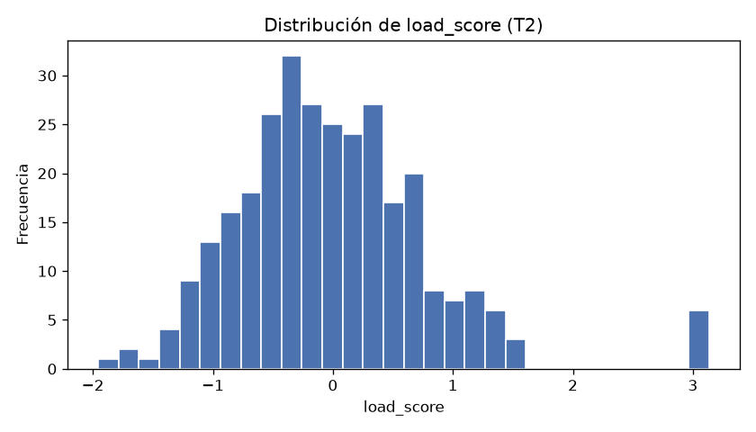

## Tarea 1 - Representar las mediciones

La clase `ServerMeasurements` almacena la matriz `values` y la tupla `feature_names`, y lanzó `ValueError` correctamente en los cuatro casos validados: matriz 1D, matriz 3D, número de columnas distinto de la cantidad de nombres y datos no numéricos (las cuatro validaciones resultaron verdaderas). `build_measurements(df)` seleccionó `gpu_utilization`, `cpu_utilization` y `memory_gb`, en ese orden, y produjo una matriz NumPy de tipo `float64` con forma (300, 3) a partir de las 300 filas del CSV. El repr obtenido fue:

```
ServerMeasurements(shape=(300, 3), features=('gpu_utilization', 'cpu_utilization', 'memory_gb'))
```

## Tarea 2 - Normalizar y calcular un indicador de carga

Las medias por columna fueron [57.9931, 50.5416, 29.4553] y las desviaciones estándar [14.4301, 12.6985, 6.5368]. No se detectó ninguna desviación estándar igual a cero, por lo que la salvaguarda contra la división por cero no intervino. Con la normalización Z-score vectorizada, `zscores` tuvo forma (300, 3) y `load_score` forma (300,). Las medias por columna de `zscores` fueron 5.6843e-16, 2.3685e-16 y -3.3159e-16 (error máximo 5.6843e-16, dentro de la tolerancia 1e-10) y las desviaciones por columna fueron 1.0, 1.0 y 1.0 (error máximo 0.0). El error máximo de `load_score` frente a `zscores @ [0.50, 0.30, 0.20]` fue 0.0, lo que confirma la equivalencia exacta con los pesos asignados.



## Tarea 3 - Identificar observaciones para revisión

Sobre una copia del DataFrame (el original permaneció sin modificar) se agregaron las columnas `load_score` y `requires_review` (dtype bool). La regla `load_score > 1.5` o `temperature_c > 80` marcó 49 de 300 filas ([cifra sin respaldo]): 9 por load_score, 42 por temperatura y 2 por ambas condiciones (9 + 42 - 2 = 49). La fila 23 obtenida coincide con la esperada en el enunciado:

| server | timestamp | load_score | temperature_c | requires_review |
|---|---|---|---|---|
| AI-SRV-01 | 2026-08-24 09:55:00 | 3.1362 | 66.97 | True |

## Tarea 4 - Construir un resumen por servidor

La tabla resumen agrupada por `server`, con las columnas en el orden exigido, fue:

| server | observations | mean_power_w | max_temperature_c | mean_load | review_count |
|---|---|---|---|---|---|
| AI-SRV-01 | 50 | 363.4598 | 86.5 | -0.6145 | 2 |
| AI-SRV-02 | 50 | 390.499 | 76.47 | -0.4177 | 1 |
| AI-SRV-03 | 50 | 416.6088 | 86.5 | -0.0859 | 2 |
| AI-SRV-04 | 50 | 434.8684 | 80.86 | -0.0030 | 5 |
| AI-SRV-05 | 50 | 471.1808 | 86.5 | 0.4536 | 12 |
| AI-SRV-06 | 50 | 495.7276 | 88.01 | 0.6676 | 27 |

Cada servidor aportó 50 observaciones y los `review_count` suman 49, coherente con las 49 filas marcadas en la Tarea 3. La recuperación del `load_score` usada para la verificación fue exacta (residuo máximo 1.5543e-15). AI-SRV-06 concentra la mayor carga media (0.6676) y la temperatura máxima global (88.01 °C), mientras que AI-SRV-01 tiene la menor carga media (-0.6145); el `load_score` nulo fue 0.

## Tarea 5 - Guardar y verificar el resultado

**Declaración:** la subtarea T5 (Tarea 5) no tiene resultado (pendiente): no se reportan sus cifras. Las cuatro verificaciones del round trip (filas antes == filas después, columnas antes == columnas después, esquema antes == esquema después y valores iguales) no fueron medidas, por lo que no se citan en este reporte. **El presupuesto de tokens se agotó: se entrega lo que se alcanzó a medir.**

El procedimiento previsto consistía en guardar el DataFrame analizado de la Tarea 3 en `output/server_analysis.parquet` mediante PyArrow, sin el índice, volver a leerlo y comparar filas, columnas, esquema y valores para imprimir el mensaje de round trip verificado. Esa ejecución y sus cuatro verificaciones quedan pendientes de medición.
