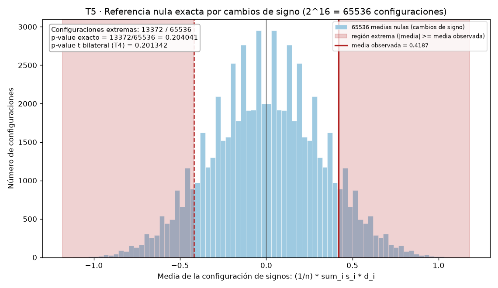
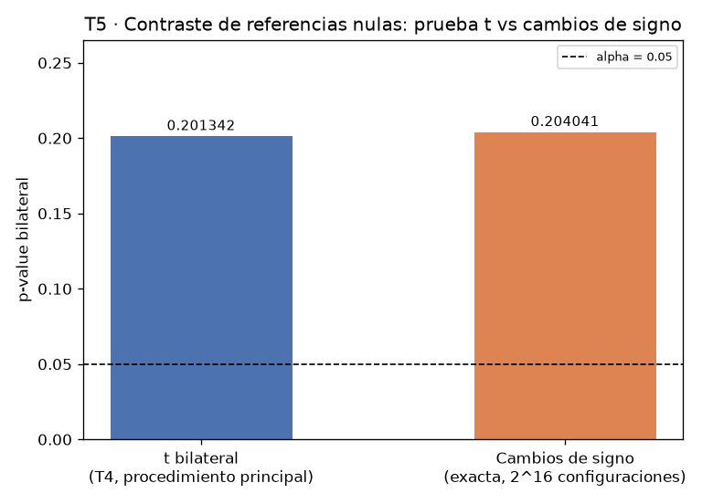
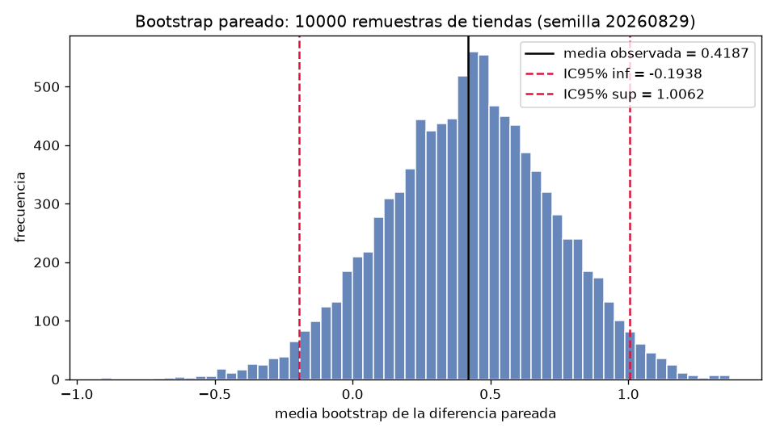

# Informe — Comparación defendible de dos modelos sobre tiendas pareadas

> **Declaraciones de entrega.** (1) La subtarea T7 (Tarea 7, ejecución integrada del pipeline en una sola corrida) no tiene resultado (pendiente): no se reportan sus cifras; los artefactos `output/store_differences.csv` y `output/store_differences.png` provienen de las subtareas de auditoría y figura (T2–T3), y la respuesta 18 cita exclusivamente cifras medidas en T2–T6. (2) El presupuesto de tokens se agotó: se entrega lo que se alcanzó a medir.

## Parte 1. Contrato de análisis previo

Respuestas registradas antes de ejecutar cualquier cálculo estadístico, conforme a la regla del enunciado.

**1. ¿Qué dos modelos se comparan?**
Se comparan los dos modelos de regresión ya entrenados, A y B, que pronostican la demanda semanal de las mismas 16 tiendas. El archivo `data/model_errors.csv` registra, por tienda, el error absoluto de cada modelo en unidades vendidas.

**2. ¿Qué población o proceso objetivo propone para interpretar el ejercicio?**
Proceso objetivo propuesto: la operación repetida de ambos modelos sobre tiendas comparables de una misma red, donde cada tienda aporta un par de errores medidos bajo condiciones compartidas (clientela, inventario, temporada). Lo que impide afirmar que los datos representan realmente esa población: los datos son sintéticos, deterministas y creados para la actividad; no provienen de tiendas reales, no existe marco muestral ni selección aleatoria, y los 16 pares no fueron muestreados de ninguna población existente. Toda generalización queda como hipótesis de trabajo, no como evidencia.

**3. ¿Cuál es la métrica principal y qué dirección representa un mejor resultado?**
La métrica principal es el error absoluto de pronóstico, en unidades vendidas; un valor menor es un mejor resultado. La comparación se realiza mediante la diferencia por tienda d_i = error_a − error_b.

**4. ¿Cuál es la unidad de análisis?**
La tienda pareada (store_id): una observación es el par (error_a, error_b) de una misma tienda; hay n = 16 pares.

**5. ¿Por qué las observaciones están emparejadas y cómo verificará los pares?**
Están emparejadas porque ambos modelos pronostican la misma tienda: los errores de A y B de una fila comparten condiciones de esa tienda y no son independientes entre sí. Verificaré los pares uniendo por la clave store_id (identificadores únicos y no nulos, correspondencia clave a clave), no comparando longitudes de vectores.

**6. Defina el estimando y la diferencia por tienda.**
El estimando es Δ = E(d_i), la media poblacional de las diferencias d_i = e_A(i) − e_B(i). Una diferencia positiva (d_i > 0) significa que el error absoluto de A excede al de B en esa tienda: el par favorece a B; una diferencia negativa favorece a A.

**7. Escriba la hipótesis nula y la alternativa bilateral.**
H0: Δ = 0 (sin diferencia media entre modelos) frente a H1: Δ ≠ 0 (bilateral).

**8. ¿Cuál será el procedimiento principal y qué supuestos requiere?**
Prueba t de una muestra sobre el vector de diferencias, alternativa bilateral (equivalente a la t pareada). Supuestos: independencia entre pares (las d_i son i.i.d. entre tiendas), media Δ y varianza finita, y distribución muestral de la media aproximada por una t con n − 1 grados de libertad (exacta si las d_i son normales; aproximada por el TLC en otro caso). Con n = 16 el supuesto de normalidad aproximada es relevante, por lo que se acompañará de referencias nulas adicionales.

**9. ¿Qué resultados reportará además del p-value?**
n, media, desviación muestral y error estándar de las diferencias; estadístico t, grados de libertad e intervalo t bilateral del 95 %; la figura por tienda con referencia en cero; conteos de signo (tiendas que favorecen a A, a B y empates); la referencia exacta por cambios de signo (total de configuraciones, conteo de extremas y p-value); y el intervalo percentil bootstrap pareado con semilla y número de remuestras.

**10. ¿Qué afirmaciones no permite realizar este diseño?**
No permite afirmar causalidad ni explicar por qué un modelo sería mejor; generalizar a tiendas, mercados o poblaciones reales (datos sintéticos); interpretar el p-value como la probabilidad de que H0 sea verdadera; concluir "no hay diferencia" a partir de no rechazar H0; ni pronunciarse sobre el desempeño fuera de estas 16 tiendas sintéticas y esta métrica.

## Parte 2. Auditoría y evidencia por tienda

**11. Confirme que los 16 pares fueron validados mediante store_id.**
La auditoría verificó que existen exactamente las columnas store_id, error_a, error_b; que cada identificador es único y no nulo; que los errores son numéricos, finitos y no negativos; y que los pares corresponden clave a clave por store_id. Todas las validaciones resultaron verdaderas y el CSV original quedó intacto. La tabla pareada guardada en `output/store_differences.csv` tiene 16 filas y 5 columnas (store_id, error_a, error_b, difference, favors). Comprobar únicamente que ambas columnas tienen la misma longitud no es suficiente: un reordenamiento, un desplazamiento de filas o un identificador faltante o duplicado emparejaría valores de tiendas distintas sin alterar las longitudes; solo la validación por store_id garantiza que cada error_a y error_b pertenecen a la misma tienda.

**12. Tiendas que favorecen a cada modelo y diferencias de mayor magnitud.**
Favorecen a B 10 tiendas (S01, S02, S03, S05, S07, S08, S10, S12, S14, S15) y favorecen a A 6 tiendas (S04, S06, S09, S11, S13, S16); no hay empates (0). La diferencia de mayor magnitud a favor de B es la de S08 (difference = 2.1000) y la de mayor magnitud a favor de A es la de S09 (difference = −1.8000). La figura `output/store_differences.png` muestra una barra horizontal por tienda con línea de referencia visible en cero: barras a la derecha (rojo) indican diferencia positiva que favorece a B y barras a la izquierda (azul), diferencia negativa que favorece a A; cada barra rotula signo y magnitud.

| store_id | error_a | error_b | difference | favors |
|---|---|---|---|---|
| S01 | 12.4 | 10.6 | 1.8000 | B |
| S02 | 9.8 | 9.1 | 0.7000 | B |
| S03 | 15.1 | 13.9 | 1.2000 | B |
| S04 | 11.0 | 12.4 | -1.4000 | A |
| S05 | 8.7 | 7.2 | 1.5000 | B |
| S06 | 13.6 | 13.9 | -0.3000 | A |
| S07 | 10.2 | 9.3 | 0.9000 | B |
| S08 | 14.9 | 12.8 | 2.1000 | B |
| S09 | 7.5 | 9.3 | -1.8000 | A |
| S10 | 16.0 | 15.0 | 1.0000 | B |
| S11 | 9.3 | 9.8 | -0.5000 | A |
| S12 | 12.8 | 11.1 | 1.7000 | B |
| S13 | 11.7 | 12.9 | -1.2000 | A |
| S14 | 8.9 | 8.3 | 0.6000 | B |
| S15 | 13.2 | 11.9 | 1.3000 | B |
| S16 | 10.6 | 11.5 | -0.9000 | A |

## Parte 3. Efecto e incertidumbre

**13. Efecto y su incertidumbre.**
n = 16; media = 0.4187; desviación muestral = 1.2534; error estándar = 0.3133, con SE = sd/√n verificado (la suma de diferencias es 6.7000). El signo positivo indica que, en promedio, error_a excede a error_b en 0.4187 unidades vendidas por tienda: un efecto medio que favorece a B (10 de 16 tiendas con diferencia positiva, 6 negativa). La desviación muestral (1.2534) describe la dispersión de las diferencias **entre tiendas** (estas van de −1.8000 a 2.1000); el error estándar (0.3133) describe la incertidumbre de la **media**: la dispersión entre tiendas es √16 = 4 veces el error estándar.

**14. Intervalo t del 95 %.**
IC t bilateral del 95 %: [−0.2491, 1.0866] unidades, con 15 grados de libertad, t crítico 2.1314 y margen 0.6679 (el intervalo coincide con media ± t crítico × EE y contiene 0). Bajo el modelo t utilizado, valores del efecto medio entre −0.2491 y 1.0866 unidades son compatibles con los datos. El intervalo no es una probabilidad posterior sobre Δ: es un rango de valores plausibles construido con el procedimiento t; en muestreos repetidos, intervalos así construidos cubrirían al parámetro en el 95 % de las veces.

## Parte 4. Referencias nulas y sensibilidad

**15. Prueba t (procedimiento principal).**
Estadístico t = 1.3364 con 15 grados de libertad; p-value bilateral = 0.2013 (la t de una muestra sobre las diferencias coincide con la t pareada). Interpretación correcta: si H0 (Δ = 0) fuera verdadera, bajo este diseño pareado y los supuestos de la prueba (diferencias i.i.d. y estadístico t con 15 gl), la probabilidad de observar un estadístico t al menos tan extremo como 1.3364 en cualquier dirección es 0.2013. No es la probabilidad de que H0 sea verdadera. Decisión: no se rechaza H0 al nivel 0.05. Más allá del binomio significativo/no significativo: el efecto puntual (0.4187) favorece a B, pero el IC [−0.2491, 1.0866] incluye 0 y efectos desde 0.2491 unidades a favor de A hasta 1.0866 a favor de B, de modo que los datos no establecen la dirección del efecto medio bajo esta referencia.

**16. Referencia exacta por cambios de signo.**
Se enumeraron las 2^16 = 65536 configuraciones de signos aplicadas al vector de diferencias observado; 13372 producen medias con magnitud al menos tan extrema como la observada (0.4187; la configuración observada y su espejo están incluidas, 6686 por cola), por lo que p = 13372/65536 = 3343/16384 = 0.2040. La distribución nula enumerada tiene media 0, desviación 0.3209 (coincide con √(Σd²)/n) y medias entre −1.18125 y 1.18125, con 184 sumas distintas.

No son procedimientos intercambiables: la prueba t deriva su referencia nula de un modelo paramétrico (diferencias i.i.d.; estadístico t con 15 gl, exacto solo bajo normalidad de las d_i) y usa magnitud y variabilidad vía la varianza estimada. La referencia por cambios de signo es no paramétrica y exacta: asume que bajo H0 el signo de cada d_i es intercambiable (simetría individual alrededor de 0), mantiene fijas las magnitudes y enumera la distribución nula completa y discreta de la media. Sus supuestos y distribuciones nulas difieren, por lo que la cercanía numérica (0.2040 frente a 0.2013; diferencia 0.0027; razón 1.0134) es propia de estos datos y no equivalencia de procedimientos; aquí ambas arrojan la misma decisión cualitativa al 5 % y al 10 %.

**17. Bootstrap pareado.**
Semilla 20260829 y 10000 remuestras de tiendas completas (filas del vector de diferencias, con reemplazo). Intervalo percentil del 95 %: [−0.1938, 1.0062] unidades. Dos ejecuciones con la misma semilla produjeron exactamente el mismo intervalo (reproducibilidad verificada); con la semilla distinta 20260830 el intervalo cambia a [−0.1875, 0.9875]. Distribución bootstrap de la media: media 0.4210, mediana 0.4250, desviación 0.3056, mínimo −0.9125, máximo 1.3688, sesgo frente a la media observada 0.0022; proporción de remuestras con media ≤ 0: 0.0881.

Se remuestrean tiendas completas porque la unidad experimental es la tienda: error_a y error_b comparten condiciones y están correlacionados. Remuestrear filas completas preserva el emparejamiento y esa correlación intra-par, de modo que la distribución bootstrap aproxima la ley muestral de la media de diferencias pareadas; remuestrear A y B por separado rompería los pares y representaría mal la variabilidad (típicamente inflada), invalidando el intervalo para este diseño. El bootstrap no corrige automáticamente: sesgos de selección o falta de representatividad, dependencia entre tiendas (estructura espacial, temporal o jerárquica), el tamaño muestral pequeño (n = 16 explora mal las colas), errores de medición o parejas mal construidas, ni violaciones del diseño; solo refleja la variabilidad presente en los datos observados. Como 0 pertenece al intervalo, la ventaja observada de B no es robusta a la variabilidad muestral a este nivel.

## Parte 5. Informe ejecutivo

**18. Informe ejecutivo (máximo 150 palabras).**

Modelos A y B comparados sobre 16 tiendas pareadas por store_id; datos sintéticos y deterministas, sin procedencia en tiendas reales. Métrica: error absoluto en unidades vendidas (menor es mejor). Efecto: diferencia media 0.4187 unidades favorece a B (10 de 16 tiendas); desviación muestral 1.2534; error estándar 0.3133; intervalo t del 95 %, [−0.2491, 1.0866], contiene 0. Procedimiento principal: prueba t pareada bilateral, t(15) = 1.3364, p = 0.2013; no se rechaza H0. Sensibilidad: cambios de signo exacto p = 0.2040 (65536 configuraciones); bootstrap percentílico [−0.1938, 1.0062] (semilla 20260829, 10000 remuestras). Limitaciones: muestra pequeña y sintética; supuestos de independencia y normalidad aproximada. No puede concluirse que B supere a A en tiendas reales ni que la diferencia poblacional sea cero; el p-value no es la probabilidad de que H0 sea verdadera.
